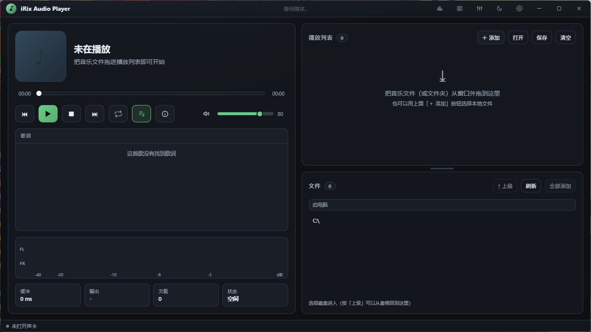
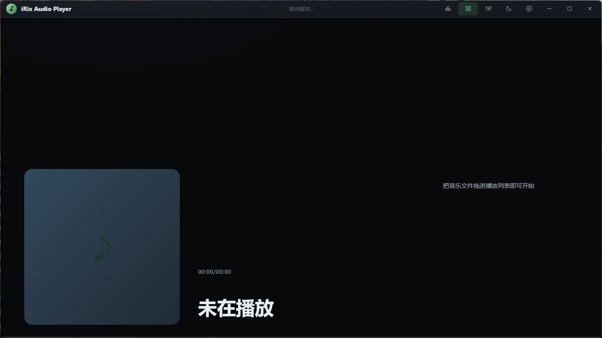
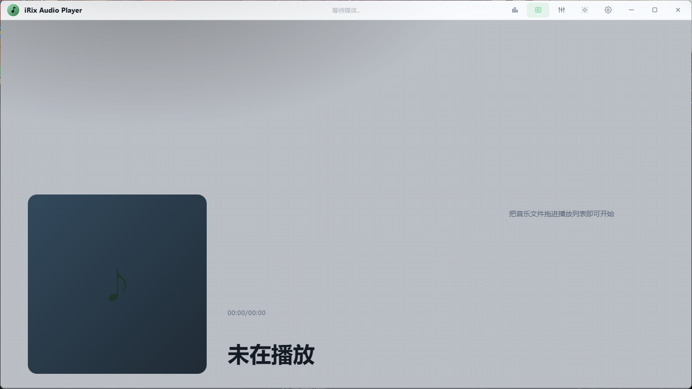
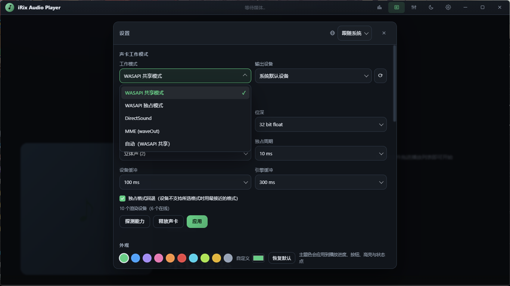

# iRix Audio Player

[中文](README.zh-CN.md) | [English](README.md) | **日本語**

> 最新バージョン：**1.0.2-extUpdate**

> PCオーディオの再生チェーンを、これ一つで完結。WASAPI 排他から WebGL ピークメーターまで、音にこだわるヘッドホン／イヤホン環境に合わせてチューニングしたプレイヤー。

**Electron** + **N-API** + **ffmpeg** の三層構成で駆動。（!!Linux 版は現状未安定のため、ビルドスクリプトなし）
> UI：左カラムにカバー／情報／コントロール、歌詞、WebGL ピークメーター、ステータスセル。右カラムにプレイリスト＋ファイルブラウザ。既定ウィンドウは 1366×768。





## 主な機能
| | |
| --- | --- |
| **フォーマット** | ffprobe / `ffmpeg -i` で形式を判定。対応形式：mp3 m4a flac wav ogg wma。ロスレス音源も ffmpeg のデコード経路へ直結 |
| **オーディオデバイス** | WASAPI 排他／共有、DirectSound、MME の 4 系統。各モードでデバイス列挙・フォーマット交渉・可用性検証まで実施 |
| **再生** | 進行バーのドラッグでシーク、音量（ホイールで ±5%）、ミュート（`M`）、リピートモード切替（リピートなし → リストリピート → 1 曲リピート → シャッフル） |
| **プレイリスト** | ウィンドウ全体へのファイルドラッグ／複数選択／フォルダー、重複排除、永続化、ドラッグ並べ替え、`.playlist` の保存・読込 |
| **歌詞** | 埋め込み歌詞 → 同ディレクトリの `.lrc` → 手動選択。現在行ハイライト＋折りたたみ可能な校正バー |
| **イコライザー** | 8 バンド EQ（20Hz–19kHz、±12dB）＋プリゲインをリアルタイム適用。プリセット 8 種、`.eq` で設定を保存・読込 |
| **外観** | プリセットテーマカラー 10 色＋カラーピッカー、ライト／ダークテーマ切替、カスタムタイトルバー |
| **情報とカバー** | 埋め込みカバー＋タイトル／アーティスト／アルバム／年／ジャンル／コーデック／コンテナ／サンプルレート／ビット深度／チャンネル／ビットレート／再生時間／パス |
| **ピークメーター** | WebGL ピークメーター（不可時は 2D canvas へフォールバック）。目盛り -40/-20/-10/-6/-3/0 dBFS、リニア振幅マッピング、実効フロア **-90 dBFS**（＝無音、バー幅ゼロ）。配色はテーマ追従、60FPS（可能な場合） |
| **変換** | 右クリックで選択項目を変換 → FLAC / Wave / MP3 / AAC / Vorbis |
| **再生ランキング** | 完聴回数でランキング |
| **全画面歌詞** | カバー＋タイトル／アーティスト／アルバム／歌詞を表示（v1.0.2-release で追加）。背景は設定のメイン背景に追従 |
| **インストール可能な拡張機能** | `.xtxs` 形式の拡張機能をインストール可能 |
| **拡張機能インターフェース ext-v2** | ライフサイクル `activate(ctx)` / `deactivate()`、高速メタデータ `readMeta()`、カバー `extractCover()`、ファイル単位の後処理 `processAudio()`、宣言型の設定／コマンド、`startup:true` による起動時アクティベート（v1.0.2-extUpdate で追加） |
| **拡張機能の修正** | コンテナ系プラグインのファイル（例：`.testext` / `.ncm`）をプレイリストへ追加しても元コンテナがそのまま ffmpeg に渡り、`Invalid data found` を招く問題を修正（v1.0.2-extUpdate） |

## 拡張機能（Extensions）

- **インストール**：設定 → 拡張機能 → **拡張機能をインストール…**（`.xtxs` = tar パッケージ）。インストール／アンインストール／切り替え後はアプリを再起動して反映；
- **開発ガイド**：[中文](EXTENSIONS.zh-CN.md) | [English](EXTENSIONS.md) | [日本語](EXTENSIONS.ja.md)；
- **テンプレートプラグイン**：[irix-extension-template](https://github.com/sakihanaraku/irix-extension-template)（独立リポジトリ、`make-sample.mjs` / `self-test.mjs` を含む）；
- **インターフェース検証プラグイン**：ワークスペースの `../irix-extension/qa/test-interfaces/`。起動時にポップアップを開いて項目ごとにセルフチェックし、再生可能な `.testext` テストファイルも生成可能；
- **インターフェース範囲**：`decode` / `readMeta` / `extractCover` / `processAudio` / ライフサイクル / 宣言型の設定とコマンド / 起動時アクティベート；
  リアルタイム DSP、任意の UI 注入、オンライン音楽ソースは、現行のインターフェースではサポート対象外です。

## はじめに

```powershell
# 1. 依存パッケージのインストール
$env:ELECTRON_MIRROR="https://npmmirror.com/mirrors/electron/"
npm install

# 2. オーディオエンジンをビルド（VS Build Tools の C++ ワークロード＋Python 3 が必要）
npm run build:native

# 3. 起動
npm start
```

手動ビルドは不要。ビルド済みの完成品を [Release](https://github.com/sakihanaraku/irix-audio-player/releases) からダウンロードできます。

- 動作環境：Windows 10/11 x64、Node ≥ 18；
- **ffmpeg 同梱**（`vendor/ffmpeg/bin/`、GPLv3 ビルド。[`THIRD-PARTY-NOTICES.md`](THIRD-PARTY-NOTICES.md) を参照）。設定で ffmpeg.exe を指定するか、`AURORA_FFMPEG`（環境変数）で上書き可能。最新ビルドへ差し替えるには `npm run fetch:ffmpeg`；
- 探索順：明示的な設定 → `AURORA_FFMPEG` → `vendor/ffmpeg/bin` → ワークスペースのツールディレクトリ → `PATH` → 一般的なインストール先。

## オーディオデバイスの動作モード

| モード | 説明 | 出力 |
| --- | --- | --- |
| `wasapi-shared` | **非排他**。フォーマット不一致時は `AUTOCONVERTPCM` を自動付与 | 設定に追従、既定 48kHz/2ch/f32 |
| `wasapi-exclusive` | **排他**：ミキサーを排す。要求フォーマット → DAC／アンプ側のネイティブフォーマット → 最も近いフォーマットの順に試行 | デバイス既定を優先 |
| `directsound` | `IDirectSound8` ＋通知ポイントによる分割充填 | 16bit（f32bit 変換）PCM |
| `mme` | WinMM `waveOut`、4 ブロックのローテーションバッファ | 16bit PCM |

エンジンバッファ（`ringMs`、既定 300ms、150/300/800/2000 から選択）は、再生チェーンのレイテンシーとピークメーター表示の同期遅延を同時に決める。モードごとにデバイス／サンプルレート／ビット深度／チャンネル／排他周期／デバイスバッファを個別指定でき、「対応能力を確認」でその出力デバイスが実際に使えるかを見極められる。

## キーボードショートカット

| 操作 | キー |
| --- | --- |
| 再生／一時停止 | `Space` |
| 5 秒戻し／送り | `←` / `→` |
| 音量 ±5% | `↑` / `↓`（または音量バー上でホイール） |
| ミュート／解除 | `M`（または音量アイコンをクリック） |
| ファイル追加 | `Ctrl+O` |
| 名前を付けて保存／プレイリストを開く | `Ctrl+S` / `Ctrl+Shift+O` |
| 最大化／復元 | タイトルバーをダブルクリック |

## パッケージング

```powershell
npm run dist:portable     # 単体 exe（%TEMP% へ自己解凍して起動）
npm run dist:setup        # NSIS インストーラー（保存先選択可、ユーザー単位インストール、管理者権限不要）
```

パッケージング前に実行中インスタンスを終了する。exe が使用中なら書き込めない。

## テスト

```powershell
npm test                  # 全テスト（dist ビルド済みならパッケージ成果物の検証を含む）
npm run test:engine       # 4 種のオーディオデバイスバックエンドを個別に実音確認
npm run test:decode       # 形式判定＋個別デコード再生＋埋め込みカバー／タグ
npm run test:app          # メインプロセスのアプリフロー（取込／重複排除／再生／シーク／モード切替）
npm run test:ipc          # 実 main.js + preload.js の IPC 契約
npm run test:ui           # 実 Chromium レンダリング＋操作アサーション＋スクリーンショット
npm run test:packaged     # 同梱 ffmpeg＋ネイティブモジュールで実音確認
```

## ディレクトリ構成

```
src/main/       メインプロセス：ウィンドウ／IPC、再生セッション、プレイリスト、ffmpeg 変換、EQ、歌詞、統計
src/preload/    contextBridge ホワイトリストブリッジ（レンダラー入口 window.aurora）
src/renderer/   UI：index.html + styles.css + renderer.js + i18n.js（中国語／日本語／英語の 3 言語）
native/         N-API オーディオエンジン（C++17）：WASAPI / DirectSound / MME / ALSA ＋ 4 バックエンドのデバイス列挙
scripts/        ビルド／パッケージング／アイコン／テストメディア
test/           エンジン、デコード、アプリフロー、IPC、UI、パッケージングの各テスト
docs/           README の参照先
LICENSES/       同梱サードパーティコンポーネントのライセンス
```

## ドキュメント

| ファイル | 内容 |
| --- | --- |
| [`THIRD-PARTY-NOTICES.md`](THIRD-PARTY-NOTICES.md) | サードパーティコンポーネントとライセンス（同梱配布する GPLv3 ffmpeg の説明を含む） |
| [`EXTENSIONS.ja.md`](EXTENSIONS.ja.md) / [中文](EXTENSIONS.zh-CN.md) / [English](EXTENSIONS.md) | `.xtxs` プラグイン開発ガイド（ext-v2：マニフェスト、インターフェース、設定／コマンド、安全性、パッケージング、投稿） |
| [irix-extension-template](https://github.com/sakihanaraku/irix-extension-template) | そのまま複製できるプラグイン雛形（独立リポジトリ、中国語／日本語／英語 README） |

## ライセンス

本プロジェクトは **MIT** で公開。詳細は [`LICENSE`](LICENSE) を参照。
インストーラーとともに配布される外部プログラムは**別ライセンス**。同梱の ffmpeg/ffprobe は **GPLv3** ビルドで、ライセンスは [`LICENSES/GPL-3.0.txt`](LICENSES/GPL-3.0.txt)、入手元とソース取得方法はサードパーティ声明を参照。

## お知らせ
> 本プロジェクトは AI 支援のもとで開発。メンテナーは厳格なレビューとテスト、更新アイデアの提供を今後も貫く。
> Issue を歓迎。提案こそ、アップデートを進める最大の原動力。
