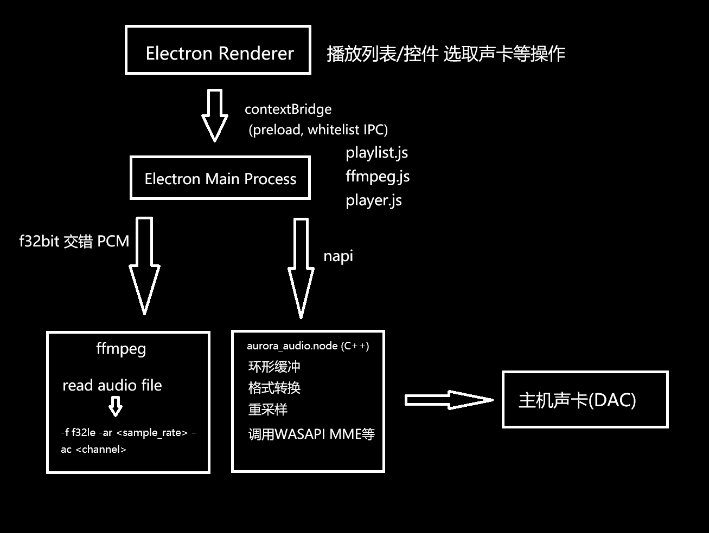

# iRix Audio Player
基于**Electron** + **N-API** + **ffmpeg**。(!!Linux版本暂时未稳定故未有构建脚本)
> 界面：左栏封面 / 信息 / 控件、歌词、WebGL 峰值计与状态格；右栏播放列表 + 文件浏览器。默认窗口 1366×768。




## 功能
| | |
| --- | --- |
| **格式** | 由 ffprobe / `ffmpeg -i` 识别 目前已知支持: mp3 m4a flac wav ogg wma |
| **声卡** | WASAPI 独占 / 共享、 DirectSound 、 MME，四种模式各自枚举设备、协商格式、探测可用性 |
| **播放** | 进度拖动定位、音量（滚轮 ±5%）、静音（`M`）、循环模式切换（不循环 → 列表循环 → 单曲循环 → 随机） |
| **播放列表** | 整窗拖入文件 / 多选 / 文件夹、去重、持久化、拖动排序、`.playlist` 存取 |
| **歌词** | 内嵌歌词 → 同目录 `.lrc` → 手动选择；当前行高亮 + 可收起的校准栏 |
| **均衡器** | 8 段（20Hz–19kHz，±12dB）+ 前级，实时生效，8 个预设，`.eq`格式存取配置 |
| **外观** | 10 个预设主题色 + 取色器、浅色/深色主题切换、自定义标题栏 |
| **信息与封面** | 内嵌封面 + 标题/艺术家/专辑/年份/流派/编码/容器/采样率/位深/声道/码率/时长/路径 |
| **峰值计** | WebGL（不可用时改用 2D canvas），刻度标签 -40/-20/-10/-6/-3/0 dBFS、线性幅度映射；数值下限 **-90 dBFS**（＝静音，条宽归零），颜色跟随主题，60FPS(如果可用) |
| **转换** | 右键选取转换 → FLAC Wave MP3 AAC Vorbis |
| **播放排行** | 按完播次数排行 |
| **全窗口歌词** | 显示封面 + 标题/艺术家/专辑/歌词 (v1.0.2-release 新增) 背景跟随设置的主背景 |
| **可安装扩展** | 可安装.xtxs格式的扩展 |
## Getting started

```powershell
# 1. 安装依赖
$env:ELECTRON_MIRROR="https://npmmirror.com/mirrors/electron/"
npm install

# 2. 编译音频引擎（需要 VS Build Tools 的 C++ 工作负载 + Python 3）
npm run build:native

# 3. 启动
npm start
```

- 环境：Windows 10/11 x64、Node ≥ 18；
- **ffmpeg 内置**（`vendor/ffmpeg/bin/`，GPLv3 构建，见 [`THIRD-PARTY-NOTICES.md`](THIRD-PARTY-NOTICES.md)）；也可在设置里指定 ffmpeg.exe、或设环境变量 `AURORA_FFMPEG` 覆盖；要换成最新构建跑 `npm run fetch:ffmpeg`；
- 查找顺序：显式设置 → `AURORA_FFMPEG` → `vendor/ffmpeg/bin` → 工作区工具目录 → `PATH` → 常见安装位置。

## 声卡工作模式

| 模式 | 说明 | 输出 |
| --- | --- | --- |
| `wasapi-shared` | **非独占**；格式不同时自动带 `AUTOCONVERTPCM` | 跟随设置，默认 48kHz/2ch/f32 |
| `wasapi-exclusive` | **独占**：不经混音器；依次尝试请求格式 → 设备原生格式 → 最接近格式 | 设备默认优先 |
| `directsound` | `IDirectSound8` + 通知点分段填充 | 16bit(f32bit转换) PCM |
| `mme` | WinMM `waveOut`，4 块轮转缓冲 | 16bit PCM |

引擎缓冲（`ringMs`，默认 300ms，可选 150/300/800/2000）同时决定播放延迟与峰值计对齐延迟。每种模式可分别选设备 / 采样率 / 位深 / 声道 / 独占周期 / 设备缓冲，并可「探测能力」看该设备到底能不能用。

## 快捷键

| 操作 | 键 |
| --- | --- |
| 播放暂停 | `Space` |
| 快退 / 快进 5 秒 | `←` / `→` |
| 音量 ±5% | `↑` / `↓`（或音量条上滚轮） |
| 静音 / 还原 | `M`（或点音量图标） |
| 添加文件 | `Ctrl+O` |
| 另存 / 打开播放列表 | `Ctrl+S` / `Ctrl+Shift+O` |
| 最大化 / 还原 | 双击标题栏 |

## 打包

```powershell
npm run dist:portable     # 单文件 exe（自解压到 %TEMP% 再启动）
npm run dist:setup        # NSIS 安装包（可自选目录、按用户安装、不需管理员）
```

打包前记得关掉正在运行的实例（exe 被占用会写不进去）。

## 测试

```powershell
npm test                  # 全部（含打包产物校验，若 dist 已构建）
npm run test:engine       # 四种声卡后端逐个实际出声
npm run test:decode       # 格式识别 + 逐个解码播放 + 内嵌封面/标签
npm run test:app          # 主进程业务流程（导入/去重/播放/定位/切模式）
npm run test:ipc          # 真实 main.js + preload.js 的 IPC 契约
npm run test:ui           # 真实 Chromium 渲染 + 交互断言 + 截图
npm run test:packaged     # 用包内 ffmpeg + 原生模块真实出声
```

## 目录结构

```
src/main/       主进程：窗口与 IPC 播放会话 播放列表 ffmpeg 转换 EQ 歌词 统计
src/preload/    contextBridge 白名单桥（渲染层入口 window.aurora）
src/renderer/   界面：index.html + styles.css + renderer.js + i18n.js（中/日/英三语）
native/         N-API 音频引擎（C++17）：WASAPI / DirectSound / MME / ALSA + 四种后端的设备枚举
scripts/        构建 / 打包 / 图标 / 测试媒体
test/           引擎 解码 业务流程 IPC UI 打包等测试
docs/           README 引用
LICENSES/       第三方组件包含的许可证
```

## 文档

| 文件 | 内容 |
| --- | --- |
| [`THIRD-PARTY-NOTICES.md`](THIRD-PARTY-NOTICES.md) | 第三方组件与许可（含随包分发的 GPLv3 ffmpeg 说明） |

## 许可

本项目以 **MIT** 发布，见 [`LICENSE`](LICENSE)。
随安装包分发的外部程序**另有其许可**：内置的 ffmpeg/ffprobe 是 **GPLv3** 构建，许可见 [`LICENSES/GPL-3.0.txt`](LICENSES/GPL-3.0.txt)，来源与源码获取方式见第三方声明。

## Notice
> 本项目在 AI 辅助下开发，维护者将一直坚持严格审查测试及提供更新创意。
> 欢迎提Issue，你的建议是我们更新最大的动力！
